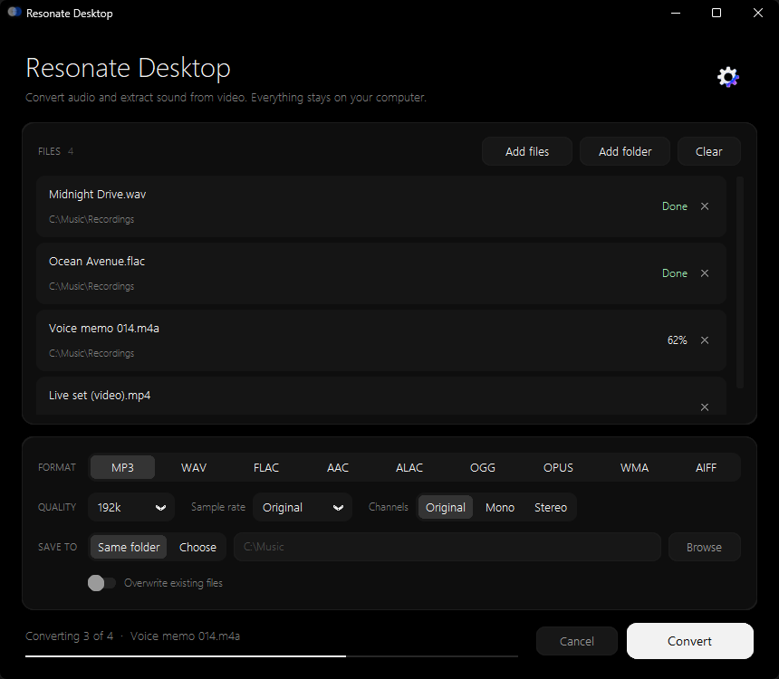
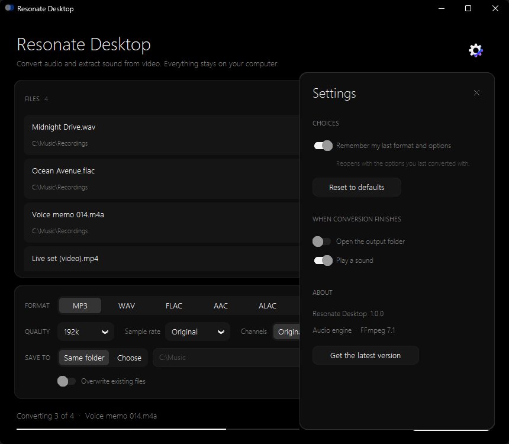

<p align="center">
  
</p>

<h1 align="center">Resonate Desktop</h1>

<p align="center">
  A minimal, black audio converter for Windows.<br>
  Convert audio files and pull the sound out of videos, in batches, entirely on your own computer.
</p>

<p align="center">
  <a href="https://github.com/Veloxstudios/resonate-desktop/releases/latest"><b>⬇ Download for Windows</b></a>
</p>



## Download

1. Go to the [latest release](https://github.com/Veloxstudios/resonate-desktop/releases/latest).
2. Download **`Resonate-Desktop.exe`**.
3. Double-click it. Nothing to install: FFmpeg is built in.

> **Windows SmartScreen** may say *"Windows protected your PC"* because the app isn't code-signed.
> Click **More info → Run anyway**.

## Features

- **9 output formats**: MP3, WAV, FLAC, AAC (M4A), ALAC (lossless M4A), OGG, OPUS, WMA, AIFF
- **Batch conversion**: add files one by one or a whole folder (subfolders included)
- **Extract audio from video**: MP4, MKV, MOV, AVI, WEBM, WMV, FLV
- **Quality controls**: bitrate (64 to 320 kbps), sample rate, mono or stereo
- **Safe by default**: never overwrites existing files unless you ask it to
- **Keeps tags**: title, artist, album and so on are carried over where the format supports them
- **Live progress** for each file and for the whole batch, with cancel
- **Settings**: remember your last choices, open the output folder when done, play a sound when done
- **100% offline**: your files never leave your computer



## Run from source

Requires Python 3.10+ on Windows.

```powershell
pip install -r requirements.txt
python resonate_desktop.py
```

## Build the .exe

```powershell
powershell -ExecutionPolicy Bypass -File build.ps1
```

The single-file app appears at `dist\Resonate Desktop.exe`.

## License

Resonate Desktop is free software, released under the [GNU GPL v3](LICENSE).

The Windows download bundles **[FFmpeg](https://ffmpeg.org)** 7.1 (the GPL v3 "essentials" build
by [gyan.dev](https://www.gyan.dev/ffmpeg/builds/), as packaged by
[imageio-ffmpeg](https://github.com/imageio/imageio-ffmpeg)). FFmpeg is a trademark of Fabrice Bellard.
FFmpeg's source code is available at [ffmpeg.org/download.html](https://ffmpeg.org/download.html).
